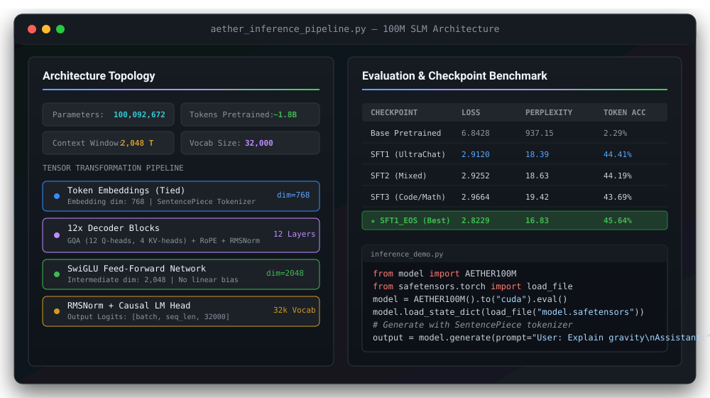

<p align="center">
  <b>English</b> · <a href="#aether-100m-language-model">简体中文</a> · <a href="#aether-100m-language-model">繁體中文</a> · <a href="#aether-100m-language-model">日本語</a> · <a href="#aether-100m-language-model">한국어</a> · <a href="#aether-100m-language-model">Türkçe</a> · <a href="#aether-100m-language-model">Русский</a> · <a href="#aether-100m-language-model">Tiếng Việt</a> · <a href="#aether-100m-language-model">ไทย</a> · <a href="#aether-100m-language-model">Deutsch</a> · <a href="#aether-100m-language-model">Español</a> · <a href="#aether-100m-language-model">Français</a> · <a href="#aether-100m-language-model">Українська</a> · <a href="#aether-100m-language-model">Polski</a> · <a href="#aether-100m-language-model">Português (Brasil)</a> · <a href="#aether-100m-language-model">فارسی</a> · <a href="#aether-100m-language-model">العربية</a> · <a href="#aether-100m-language-model">Bahasa Indonesia</a> · <a href="#aether-100m-language-model">Italiano</a>
</p>

---

<h1 align="center">Aether: 100M Language Model</h1>

<p align="center">
  <b>An experimental ~100M decoder-only language model built and pretrained from scratch, then instruction fine-tuned with LoRA.</b>
</p>

<p align="center">
  Explore the end-to-end small language model lifecycle: tokenizer design, architecture, pretraining, LoRA fine-tuning, and empirical evaluations.
</p>

<p align="center">
  
  
  
  
  
  
  
</p>

<div align="center">
  <a href="#evaluation">
    
  </a>
</div>

<br>

<p align="center">
  <a href="#project-goals"><b>Project Goals</b></a> •
  <a href="#model-overview"><b>Model Overview</b></a> •
  <a href="#architecture"><b>Architecture</b></a> •
  <a href="#pretraining"><b>Pretraining</b></a> •
  <a href="#supervised-fine-tuning"><b>Supervised Fine-Tuning</b></a> •
  <a href="#evaluation"><b>Evaluation</b></a> •
  <a href="#using-the-model"><b>Quick Start</b></a> •
  <a href="#checkpoints-and-artifacts"><b>Checkpoints</b></a>
</p>

<p align="center">
  <code>git clone https://github.com/kapilverse/Aether.git &amp;&amp; pip install torch sentencepiece safetensors</code>
</p>

<p align="center">
  
</p>

<div align="center">
  <table align="center" style="border: 1px solid #30363d; border-radius: 8px; margin: 16px auto;">
    <tr>
      <td align="center" style="padding: 16px 32px;">
        <p align="center">
          <a href="https://huggingface.co/kapilverse/Aether">
            
          </a>
        </p>
        <p align="center">
          <b><a href="https://huggingface.co/kapilverse/Aether">Join the Aether Model &amp; Research Discussion</a></b><br>
          <sub>Checkpoints &bull; SafeTensors &bull; Evaluation Metrics &bull; Reproduction Scripts</sub>
        </p>
      </td>
    </tr>
  </table>
</div>

---

> [!NOTE]
> **Status & Intended Use:** The training and fine-tuning pipelines ran successfully, and model weights are available. However, generation quality remains an expected limitation for this scale: outputs can be repetitive, incoherent, or incorrect. Aether is an educational and research artifact demonstrating end-to-end SLM engineering, not a production assistant.

---

## 🎯 Project Goals

1. **Implement a custom decoder-only Transformer** with modern architectural primitives (RoPE, GQA, RMSNorm, SwiGLU).
2. **Train a custom SentencePiece tokenizer** with specialized control tokens.
3. **Pretrain from scratch** on approximately 1.8 billion tokens with high hardware throughput.
4. **Instruction fine-tune with LoRA** across conversational, multi-turn, coding, and mathematical datasets.
5. **Merge trained LoRA adapters** into standalone, self-contained model checkpoints.
6. **Rigorously evaluate checkpoints** on held-out loss, perplexity, and next-token prediction metrics.
7. **Empirically study generation dynamics**, repetitive degeneration, and EOS/stopping conditions.
8. **Package and document artifacts** for open research and Hugging Face distribution.

---

## 📋 Model Overview

| Property | Value |
|---|---|
| **Model Name** | Aether |
| **Model Type** | Decoder-only causal language model |
| **Parameter Count** | 100,092,672 (~100M) |
| **Pretraining Tokens** | 1,800,011,776 (~1.8B) |
| **Vocabulary Size** | 32,000 |
| **Context Length** | 2,048 tokens |
| **Tokenizer** | SentencePiece (`tokenizer/aether.model`) |
| **Positional Encoding** | Rotary Positional Embeddings (RoPE) |
| **Attention Mechanism** | Grouped-Query Attention (GQA: 12 Q-heads, 4 KV-heads) |
| **Normalization** | RMSNorm (`eps=1e-6`) |
| **Feed-Forward Layer** | SwiGLU (dim=2048) |
| **Embedding Tying** | Input embeddings and output projection tied |
| **Target Hardware** | NVIDIA GPU (PyTorch with CUDA) |

---

## 🏗️ Architecture

```
                 ┌────────────────────────────────┐
                 │          Input Tokens          │
                 └──────────────┬─────────────────┘
                                │
                 ┌──────────────▼─────────────────┐
                 │  Tied Token Embeddings (d=768) │
                 └──────────────┬─────────────────┘
                                │
                 ┌──────────────▼─────────────────┐
                 │   12x Transformer Decoder      │
                 │   ├── RMSNorm                  │
                 │   ├── GQA (12 Q-heads, 4 KV)   │
                 │   │   └── Rotary Embeds (RoPE) │
                 │   ├── RMSNorm                  │
                 │   └── SwiGLU FFN (dim=2048)    │
                 └──────────────┬─────────────────┘
                                │
                 ┌──────────────▼─────────────────┐
                 │       Final RMSNorm Layer      │
                 └──────────────┬─────────────────┘
                                │
                 ┌──────────────▼─────────────────┐
                 │ Causal LM Head (Logits: 32k)   │
                 └────────────────────────────────┘
```

The architecture details:
- **12 Transformer layers**
- **Hidden size:** 768
- **Query attention heads:** 12
- **Key/value attention heads:** 4 (grouped-query attention factor of 3x)
- **Head dimension:** 64
- **Feed-forward intermediate size:** 2,048
- **Vocabulary:** 32,000 tokens
- **Context length:** 2,048 tokens
- **RMSNorm epsilon:** `1e-6`
- **Dropout:** `0`
- **Linear biases:** disabled across all projections
- **Weight tying:** token embeddings and output projection share weights

> [!IMPORTANT]
> **Compatibility Notice:** Aether uses a custom model implementation (`model/aether.py`). It is not a drop-in Hugging Face `transformers.AutoModelForCausalLM` without custom model code registration. Use the provided loading scripts and model definitions.

---

## 🔤 Tokenizer and Text Format

The tokenizer model is stored at `tokenizer/aether.model`.

| Token | ID | Description |
|:---:|:---:|---|
| `<unk>` | 0 | Unknown token |
| `<s>` | 1 | Beginning of sequence (BOS) |
| `</s>` | 2 | End of sequence (EOS) |
| `<pad>` | 3 | Padding token |

### Instruction Template Format
Instruction fine-tuning formats multi-turn dialogue with explicit role labels:

```text
User:
The user's message

Assistant:
The assistant's response
```

During SFT, loss is computed exclusively over the assistant tokens; user and system tokens are masked with label `-100`.

---

## ⚡ Pretraining

The base model was trained from scratch before supervised fine-tuning.

| Metric | Result |
|---|---:|
| **Tokens Processed** | 1,800,011,776 (~1.8B) |
| **Training Duration** | 11.31 hours |
| **Average Throughput** | 20,379 tokens/second |
| **Total Training Steps** | 13,733 |
| **Best Validation Loss** | 4.31079 |
| **Best Checkpoint Step** | 13,600 |

### Base-Model Benchmark Results

| Benchmark | Score | Detail |
|---|---:|---|
| **ARC-Easy** | 39.18% | 931 / 2,376 correct |
| **HellaSwag** | 26.59% | Zero-shot normalized completion |

---

## 🧪 Supervised Fine-Tuning (SFT)

Fine-tuning leveraged Low-Rank Adaptation (LoRA) on attention projection modules (`q_proj`, `k_proj`, `v_proj`, `o_proj`), followed by weight merging into full checkpoint tensors.

### Shared LoRA Configuration
- **Rank ($r$):** 16
- **Alpha ($\alpha$):** 32
- **Dropout:** 0.05
- **Trainable Parameters:** 983,040 (~0.98% of total model weights)

### Iteration Summary

<details open>
<summary><b>SFT1: UltraChat (Conversational Foundations)</b></summary>

- **Dataset:** `HuggingFaceH4/ultrachat_200k` (20,000 examples)
- **Duration:** 1 epoch
- **Base Checkpoint:** Pretrained base model (`checkpoints/best.pt`)
- **Merged Checkpoint:** `sft/merged/aether_100m_sft.pt`
- **Result:** Drastic improvement in held-out next-token prediction over the base model.
</details>

<details>
<summary><b>SFT2: Mixed Instruction & Technical Data</b></summary>

- **Dataset:** 4,844 multi-source examples:
  - General: `magpie_general` (1,200), `oasst2_general` (800)
  - Python / Coding: `self_oss_instruct` (700), `codefeedback_py` (500), `codefeedback_sql` (300)
  - Technical: `magpie_tech` (300), `codefeedback_tech` (250), `oasst2_tech` (44)
  - Constraints / Rewrite: `smol_constraints` (350), `tulu3_if` (300), `smol_rewrite` (100)
- **Merged Checkpoint:** `sft/merged/aether_100m_sft2.pt`
</details>

<details>
<summary><b>SFT3: Coding and Math Specialization</b></summary>

- **Dataset:** 12,000 audited examples:
  - Glaive code assistant (5,000)
  - Dolly (4,000)
  - Orca Math (2,000)
  - GSM8K (1,000)
- **Merged Checkpoint:** `sft/merged/aether_100m_sft3.pt`
</details>

<details open>
<summary><b>SFT1_EOS: Explicit EOS Supervision Experiment</b></summary>

- **Motivation:** Standard SFT1 string tokenization did not append the special EOS token ID to assistant responses.
- **Protocol:** Explicitly appended `tokenizer.sp.eos_id()` to assistant target labels.
- **Merged Checkpoint:** `sft/merged/aether_100m_sft_eos.pt`
- **Result:** Produced the **best loss, perplexity, and token accuracy** across all experiments.
</details>

---

## 📊 Evaluation & Benchmarks

All checkpoints were evaluated on an identical held-out test set consisting of **500 examples** (442,453 assistant tokens).

| Checkpoint | Supervised Loss ↓ | Perplexity ↓ | Token Accuracy ↑ | Primary Characteristics |
|:---|:---:|:---:|:---:|---|
| **Base Model** | 6.8429 | 937.16 | 2.29% | Raw next-token pretraining |
| **SFT1 (UltraChat)** | 2.9120 | 18.39 | 44.41% | First instruction tuning |
| **SFT2 (Mixed)** | 2.9253 | 18.64 | 44.19% | Broad domain coverage |
| **SFT3 (Code/Math)** | 2.9664 | 19.42 | 43.69% | Technical & mathematical focus |
| 🏆 **SFT1_EOS (Best)** | **2.8229** | **16.83** | **45.64%** | Explicit EOS supervision |

### Key Research Findings
- **SFT1 dramatically closed the gap** from the base model (perplexity dropped from 937 to 18.39).
- **Explicit EOS supervision achieved peak performance** across all evaluation dimensions.
- **Metric vs. Generation Divergence:** Lower validation loss did not directly eliminate degeneration or repetition in unconstrained sampling.

---

## 🚀 Using the Model

### 1. Installation

```bash
git clone https://github.com/kapilverse/Aether.git
cd Aether
pip install torch sentencepiece safetensors
```

### 2. Python Inference

```python
import torch
import sentencepiece as spm
from safetensors.torch import load_file
from model import AETHER100M

device = "cuda" if torch.cuda.is_available() else "cpu"

# 1. Initialize architecture
model = AETHER100M().to(device)

# 2. Load SafeTensors or PyTorch weights
state_dict = load_file("model.safetensors", device="cpu")
model.load_state_dict(state_dict, strict=True)
model.eval()

# 3. Load SentencePiece Tokenizer
tokenizer = spm.SentencePieceProcessor(model_file="tokenizer/aether.model")

# 4. Format Prompt
prompt = "User:\nExplain what a Python dictionary is.\n\nAssistant:\n"
input_ids = torch.tensor([tokenizer.encode(prompt)], device=device)

# 5. Generate Tokens
with torch.no_grad():
    output_ids = model.generate(input_ids, max_new_tokens=100, temperature=0.8, top_k=50)

print(tokenizer.decode(output_ids[0].tolist()))
```

---

## 📦 Checkpoints and Artifacts

| Artifact | Format | Description |
|---|---|---|
| `checkpoints/best.pt` | PyTorch (`.pt`) | Best base model checkpoint (step 13,600) |
| `checkpoints/latest.pt` | PyTorch (`.pt`) | Final rolling pretraining checkpoint |
| `sft/merged/aether_100m_sft.pt` | PyTorch (`.pt`) | Merged SFT1 checkpoint |
| `sft/merged/aether_100m_sft2.pt` | PyTorch (`.pt`) | Merged SFT2 checkpoint |
| `sft/merged/aether_100m_sft3.pt` | PyTorch (`.pt`) | Merged SFT3 checkpoint |
| `sft/merged/aether_100m_sft_eos.pt` | PyTorch (`.pt`) | Merged SFT1 checkpoint with EOS supervision |
| `tokenizer/aether.model` | SentencePiece | Trained 32k vocabulary model |
| `Aether-HF/model.safetensors` | SafeTensors | Hugging Face distribution checkpoint |
| `Aether-HF/config.json` | JSON | Architecture parameters & hyperparameter config |

---

## ⚠️ Limitations & Responsible Use

- **Repetition & Degeneration:** Outputs may repeat phrases or fall into repetitive token loops during open-ended text generation.
- **Factuality:** Small language models have limited parameter capacity and can hallucinate factual claims.
- **Safety Critical Tasks:** Aether is an exploratory research project. It is **not** intended for medical, legal, financial, or safety-critical applications.
- **Code Generation:** Syntactic patterns may appear correct, but generated code must be reviewed and tested before execution.

---

## 📜 Dataset Attribution & Licensing

Aether's experiments utilized subsets from several open research datasets:
- **UltraChat** (`HuggingFaceH4/ultrachat_200k`)
- **OpenAssistant 2** (`OASST2`)
- **Magpie**, **Self-OSS-Instruct**, **CodeFeedback**
- **Glaive Code Assistant**, **Databricks Dolly**, **Orca Math**, **GSM8K**

Please consult the respective source dataset licenses before redistributing downstream checkpoints.

---

<p align="center">
  <sub>Built for transparent small language model research &bull; <a href="https://github.com/kapilverse/Aether">kapilverse/Aether</a></sub>
</p>
